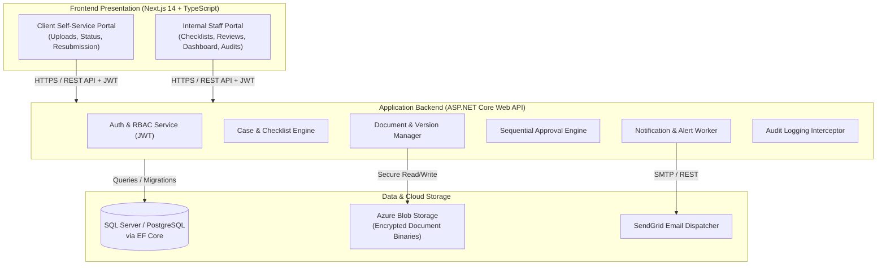
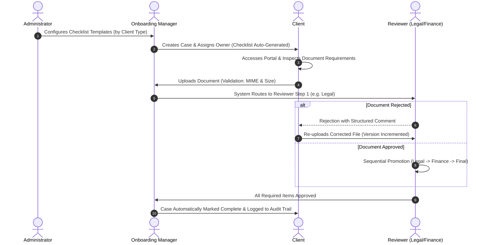

<div align="center">

# 📑 onboardFlow
### Client Onboarding & Document Workflow Portal

[](https://nextjs.org/)
[](https://www.typescriptlang.org/)
[](https://dotnet.microsoft.com/)
[](https://docs.microsoft.com/en-us/dotnet/csharp/)
[](https://learn.microsoft.com/en-us/ef/core/)
[](https://www.postgresql.org/)
[](https://azure.microsoft.com/)
[](https://www.docker.com/)
[](#)

<p align="center">
  <b>A centralized, enterprise-grade web application to streamline client document collection, validation, and multi-tier sequential approval workflows.</b>
</p>

[Key Features](#-key-features) • [System Architecture](#-system-architecture) • [User Roles & RBAC](#-user-roles--access-control) • [Tech Stack](#-technology-stack) • [Getting Started](#-getting-started) • [API & Documentation](#-api--documentation) • [Team Decipher](#-team-decipher)

---

</div>

## 📌 Executive Summary

When organizations onboard new clients (e.g., Enterprise, SME, Partners), they collect diverse sensitive documentation—statutory tax records, business registration files, director identification, bank validations, and nondisclosure contracts. Traditionally, these workflows run over fragmented email threads, creating severe bottlenecks:
- **Zero Centralized Auditability**: Lost files and untracked reviewer approvals/rejections.
- **Compliance & Security Exposure**: Ad-hoc document forwarding violating GDPR, CCPA, and data privacy principles.
- **Client Blind Spots**: Lack of visibility for clients regarding requested, outstanding, or rejected documents.
- **Workflow Deadlocks**: Approval delays when review responsibilities and deadlines are opaque.

**onboardFlow** replaces manual email exchanges with an automated, auditable, role-based workflow platform. Built with **Next.js**, **ASP.NET Core**, **EF Core**, and **Azure Blob Storage**, it offers dynamic checklist generation, granular sequential review pipelines (Legal → Finance → Executive Approval), instant versioning, real-time analytics dashboards, and an isolated self-service client portal.

---

## 🚀 Key Features

### 🏢 1. Dynamic Checklist Management & Case Creation
- **Client-Type Templates**: Pre-configured checklists mapped to client tiers (*Enterprise*, *SME*, *Partner*).
- **Auto-Generation**: Automatic generation of checklists and due dates upon case inception.
- **Item Reordering & Rules**: Mark items as mandatory or optional with designated reviewers.

### 📤 2. Secure Document Upload & Version Retention
- **Automated Validation**: Rigorous MIME-type filtering and file size limits.
- **Immutable Version History**: Re-uploading rejected files retains complete historic version chains.
- **Cloud Storage**: Secure binary storage backed by Azure Blob Storage.
- **Safe Deletion**: Deletion requests require recorded rationale and are permanently logged.

### 🔀 3. Sequential Approval Pipelines & Delegation
- **Multi-Stage Review**: Sequential review routing (e.g., *Legal Review* → *Finance Review* → *Final Approval*).
- **Feedback Loop**: Structured rejections with mandatory reviewer feedback returned directly to the client.
- **Delegation & Reassignment**: Managers can reassign stuck tasks to ensure workflow continuity.
- **Deadline Tracking**: Real-time identification of overdue approvals.

### 📊 4. Progress Timeline & Real-Time Dashboards
- **Visual Progress Tracker**: Real-time progress bars and percentage calculation per case.
- **Status Badges & Bottlenecks**: Immediate visual alerts for *Pending*, *Under Review*, *Approved*, *Rejected*, *Blocked*, or *Overdue* items.
- **Executive Analytics**: Metrics on case turnaround time, reviewer workload distribution, and stage drop-offs.
- **Data Export**: Export dashboards and audit trails directly to CSV/Excel spreadsheets.

### 🔒 5. Regulatory Compliance, Audit Trails & Security
- **Full Traceability**: Granular audit log capturing `User`, `Action`, `Timestamp`, and `Target Record`.
- **RBAC & Isolation**: Strict segregation ensuring clients access only their specific onboarding instance.
- **Data Privacy**: Cryptographic protections (TLS in-transit, AES-256 at-rest) aligning with GDPR and CCPA guidelines.
- **Data Retention Policies**: Automated archiving and safe PII purging mechanisms.

---

## 🏛️ System Architecture



---

## 🔄 End-to-End Workflow



---

## 👥 User Roles & Access Control

| Role | Scope & Permissions | Key Capabilities |
| :--- | :--- | :--- |
| **Administrator** | System-wide configuration | User account provisioning, role definitions, checklist template creation, system settings, global audit inspection. |
| **Onboarding Manager** | Case lifecycle & oversight | Open onboarding cases, assign case owners, monitor bottlenecks, follow up on delayed approvals, reassign reviewers. |
| **Reviewer** | Document verification | Access assigned document queues, approve/reject submissions with comments, track review deadlines. |
| **Client** | Restricted self-service portal | Secure login to personal case only, view requested items, upload and replace documents, monitor real-time completion progress. |

---

## 🛠️ Technology Stack

| Layer | Technology | Details / Purpose |
| :--- | :--- | :--- |
| **Frontend** | [Next.js](https://nextjs.org/) (React 18+) | Server-side rendering, routing, responsive client and staff interfaces |
| **Language (Frontend)** | [TypeScript](https://www.typescriptlang.org/) | Type safety, maintainability, and contract synchronization |
| **Backend API** | [ASP.NET Core Web API](https://dotnet.microsoft.com/) | High-performance C# RESTful backend |
| **Data Access** | [Entity Framework Core](https://learn.microsoft.com/en-us/ef/core/) | Code-first migrations, repository abstractions, LINQ queries |
| **Database** | [PostgreSQL](https://www.postgresql.org/) / [SQL Server](https://www.microsoft.com/sql-server) | Relational persistence for cases, audits, and checklists |
| **File Storage** | [Azure Blob Storage](https://azure.microsoft.com/products/storage/blobs/) | Encrypted, scalable cloud storage for uploaded documents |
| **Authentication** | [JWT Bearer Tokens](https://jwt.io/) | Stateless authentication with Role-Based Access Control (RBAC) |
| **Notifications** | [SendGrid](https://sendgrid.com/) & Webhooks | Automated email triggers for assignments, rejections, and overdue items |
| **Testing** | [xUnit](https://xunit.net/) & [Jest](https://jestjs.io/) | Unit/integration tests for backend APIs and frontend components |
| **DevOps & Containers** | [Docker](https://www.docker.com/) & [GitHub Actions](https://github.com/features/actions) | Docker Compose local stack & automated CI/CD pipeline to Azure |

---

## 📁 Repository Structure

```plaintext
onboardFlow/
├── .github/
│   └── workflows/
│       ├── backend-ci.yml           # CI/CD: .NET build & xUnit test suite
│       └── frontend-ci.yml          # CI/CD: Next.js lint, build & Jest tests
├── src/
│   ├── client/                      # Next.js TypeScript Frontend Application
│   │   ├── public/                  # Static assets & brand media
│   │   ├── src/
│   │   │   ├── app/                 # Next.js App Router (Client & Admin routes)
│   │   │   ├── components/          # Reusable UI components (Modals, Badges, Tables)
│   │   │   ├── hooks/               # Custom React state & data-fetching hooks
│   │   │   ├── services/            # API client wrappers & Axios interceptors
│   │   │   └── types/               # Shared TypeScript schemas
│   │   ├── package.json
│   │   └── tsconfig.json
│   │
│   └── server/                      # ASP.NET Core Web API
│       ├── OnboardFlow.API/         # API Controllers, Middleware & Program.cs
│       ├── OnboardFlow.Core/        # Domain entities, Enums & Interface definitions
│       ├── OnboardFlow.Application/ # Business logic, MediatR/Services, DTOs & Mappings
│       ├── OnboardFlow.Infrastructure/ # EF Core DbContext, Azure Blob Storage, SendGrid
│       └── OnboardFlow.Tests/       # xUnit Unit & Integration test projects
│
├── docker/
│   ├── Dockerfile.frontend
│   ├── Dockerfile.backend
│   └── docker-compose.yml           # Local multi-container development environment
├── docs/                            # Project specifications, PRD & Architecture diagrams
└── README.md
```

---

## ⚙️ Getting Started

### Prerequisites
- [Git](https://git-scm.com/)
- [.NET 8.0 SDK](https://dotnet.microsoft.com/download/dotnet/8.0)
- [Node.js (v18+ or v20 LTS)](https://nodejs.org/) & `npm`
- [Docker Desktop](https://www.docker.com/products/docker-desktop) *(Optional, for containerized run)*

---

### Option A: Running via Docker Compose (Recommended)

1. **Clone the repository:**
   ```bash
   git clone https://github.com/Team-Decipher/onboardFlow.git
   cd onboardFlow
   ```

2. **Configure environment variables:**
   ```bash
   cp .env.example .env
   ```

3. **Build and spin up all services:**
   ```bash
   docker compose up --build
   ```
   - **Frontend App**: `http://localhost:3000`
   - **Backend API & Swagger**: `http://localhost:5000/swagger`
   - **Database (PostgreSQL / SQL Server)**: `localhost:5432` / `localhost:1433`

---

### Option B: Manual Local Setup

#### 1. Backend Setup (.NET Core Web API)
```bash
cd src/server/OnboardFlow.API

# Restore dependencies
dotnet restore

# Apply Entity Framework database migrations
dotnet ef database update --project ../OnboardFlow.Infrastructure

# Launch API service
dotnet run
```
*API will run on `https://localhost:7001` or `http://localhost:5000`.*

#### 2. Frontend Setup (Next.js)
```bash
cd src/client

# Install dependencies
npm install

# Run the development server
npm run dev
```
*Web client will run on `http://localhost:3000`.*

---

## 🔐 Environment Variables

Create a `.env` file in the root or in the respective client/server directories:

```env
# ==========================================
# Backend Configuration (ASP.NET Core)
# ==========================================
ASPNETCORE_ENVIRONMENT=Development
ConnectionStrings__DefaultConnection="Host=localhost;Port=5432;Database=OnboardFlowDb;Username=postgres;Password=your_secret_password;"
JwtSettings__SecretKey="SuperSecretKeyWithSufficientLengthForHS256SecurityPolicy"
JwtSettings__Issuer="OnboardFlowAPI"
JwtSettings__Audience="OnboardFlowClients"
JwtSettings__ExpiryInMinutes=60

AzureBlobStorage__ConnectionString="DefaultEndpointsProtocol=https;AccountName=...;AccountKey=...;"
AzureBlobStorage__ContainerName="onboardflow-documents"

SendGrid__ApiKey="SG.your_sendgrid_api_key"
SendGrid__SenderEmail="noreply@onboardflow.com"

# ==========================================
# Frontend Configuration (Next.js)
# ==========================================
NEXT_PUBLIC_API_BASE_URL="http://localhost:5000/api"
```

---

## 🧪 Testing

### Backend Unit & Integration Tests (xUnit)
```bash
cd src/server
dotnet test --logger "console;verbosity=detailed"
```

### Frontend Tests (Jest & React Testing Library)
```bash
cd src/client
npm run test
```

---

## 👥 Team Decipher

This project is developed as part of the **Level 2 Software Development Project** at the **Faculty of Information Technology, University of Moratuwa (2026)**.

**Project Supervisor:** Ms. M. N. Chandimali

| Member | Student ID | Email | Primary Responsibilities |
| :--- | :--- | :--- | :--- |
| **Narangoda LNMC** | `244138C` | `narangodalnmc.24@uom.lk` | Approval routing, sequential review pipelines, API rules & architecture coordination, shared Next.js front-end shell. |
| **Jayanath SP** | `244083C` | `jayanathsp.24@uom.lk` | Checklist management, document uploads & validation, Azure Blob Storage integration & Azure App Service deployment. |
| **Nimeshika CD** | `244144P` | `nimeshikacd.24@uom.lk` | JWT Authentication & RBAC, client organization/types, case owner assignment, GitHub Actions CI/CD pipelines. |
| **Udyani MHS** | `244212A` | `udyanimhs.24@uom.lk` | Progress timeline & percentage tracking, notification system, document version history, Docker Compose environment. |
| **Priyanka GK** | `244238H` | `priyankagk.24@uom.lk` | System audit logging & filtering, executive analytics dashboard & bottleneck reporting, overdue reminders & test fixtures. |

---

## 📄 License & Academic Attribution
Developed for academic assessment at the **University of Moratuwa, Sri Lanka**. All rights reserved by **Team Decipher**.
