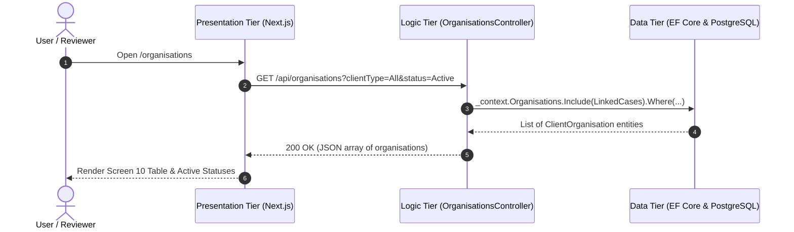
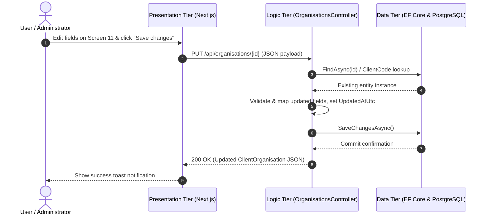

# 🏛️ 3-Tier Architecture Documentation: Client Organisations

This document details the architectural design and tier-by-tier separation of concerns for the **Client Organisations** module in the **onboardFlow** application.

---

## 1. Architectural Philosophy & Overview

The Client Organisations feature strictly adheres to the classical **3-Tier Enterprise Architecture pattern**:
1. **Presentation Tier (Frontend Layer)**
2. **Business / Application Logic Tier (Backend API Layer)**
3. **Data Persistence Tier (Database & ORM Layer)**

Each tier is completely decoupled, ensuring modularity, independent scalability, robust maintainability, and enterprise-grade testability.

```mermaid
flowchart TB
    subgraph Tier1["1. Presentation Tier (Frontend - Next.js 14 / TypeScript)"]
        direction TB
        OrgPage["Organisations Page (/organisations)\nScreen 10"]
        OrgDetailsPage["Organisation Details Page (/organisations/[id])\nScreen 11"]
        AddModal["Add Organisation Modal"]
        TabsView["Tab Controller (Details | Cases | Access)"]
        StateEngine["React Hooks & Optimistic Fallback Engine"]

        OrgPage --> AddModal
        OrgPage --> OrgDetailsPage
        OrgDetailsPage --> TabsView
        OrgPage -.-> StateEngine
        OrgDetailsPage -.-> StateEngine
    end

    subgraph Tier2["2. Application Logic Tier (Backend - ASP.NET Core Web API)"]
        direction TB
        Controller["OrganisationsController (/api/organisations)"]
        ModelValidator["Input Validation & Auto Client-Code Generator"]
        DTOs["DTOs (CreateOrganisationRequest, UpdateOrganisationRequest)"]
        CORS["CORS Policy & Routing Middleware"]

        CORS --> Controller
        Controller --> ModelValidator
        Controller --> DTOs
    end

    subgraph Tier3["3. Data Persistence Tier (PostgreSQL + Entity Framework Core)"]
        direction TB
        DbContext["AppDbContext (EF Core)"]
        DbSeed["Database Auto-Migrate & Seeder (Program.cs)"]
        TableOrg[("ClientOrganisations Table\n- PK: Id (UUID)\n- Unique: ClientCode\n- Attributes: Name, City, Type, Contact...")]
        TableCases[("LinkedCases Table\n- PK: Id (UUID)\n- FK: OrganisationId\n- Progress, Reviewer, Status...")]

        DbContext --> TableOrg
        DbContext --> TableCases
        DbSeed --> DbContext
    end

    Tier1 -->|HTTP REST + JSON (Port 5000 / 8080)| Tier2
    Tier2 -->|EF Core ORM / Npgsql PostgreSQL Driver| Tier3
```

---

## 2. Tier 1: Presentation Tier (Frontend)

### Technologies
- **Framework**: Next.js 14 (React 18 / 19, App Router)
- **Language**: TypeScript (`strict: true`)
- **Styling**: Tailwind CSS with custom branding colors (`#0d282f`, `#007a78`, `#123137`)
- **State Management**: React `useState`, `useEffect`, `useMemo`

### Component & Screen Architecture
1. **Screen 10 (`/organisations`)**:
   - `OrganisationsPage`: Main client directory page.
   - **Sidebar**: Highlighting `Client organisations`, with quick links to `User accounts` (`/users`) and exit flow.
   - **Filter Toolbar**: Instant client search by name, code (`CLI-0018`), city (`Colombo`), or contact person. Select dropdowns for `Client type` (`All`, `Enterprise`, `SME`, `Partner`) and `Status` (`Active`, `Inactive`).
   - **Data Table**: Rendered to match Screen 10 wireframe with organization name, location subtext, tier, contact person, active case indicators, and `Edit →` navigation.
   - **Add Modal**: Lightweight modal for immediate creation of a new client record with instant state insertion.

2. **Screen 11 (`/organisations/[id]`)**:
   - `OrganisationDetailsPage`: Detailed view & editing screen for a selected client organisation.
   - **Header Subtitle**: Dynamic display of `[Organisation Name] / [Client Code]`.
   - **Tabs System**:
     - `Organisation details`: Form with 2-column responsive layout, field validations, and `Save changes` action.
     - `Linked cases`: Active onboarding workflows, status indicators, and progress bars.
     - `Client access`: Authorized client contact logins, roles, and credential management.

### Offline & Resilience Architecture
To ensure seamless execution even when the backend API or Docker container is offline or during initial startup:
- Both pages embed `INITIAL_ORGANISATIONS` fallback data matching the official mockups.
- All fetch operations are wrapped in `try/catch` handlers that fall back to local optimistic state updates with user toast feedback.

---

## 3. Tier 2: Application Logic Tier (Backend API)

### Technologies
- **Platform**: ASP.NET Core Web API (target framework `net10.0`)
- **Language**: C# 12 / 13 with Nullable Reference Types enabled
- **Controller**: `OrganisationsController` extending `ControllerBase`

### Responsibilities & Business Rules
1. **Controller Routing (`/api/organisations`)**:
   - `GET /api/organisations`: Accepts query parameters `search`, `clientType`, and `status`. Eagerly loads linked cases via `.Include(o => o.LinkedCases)`.
   - `GET /api/organisations/{id}`: Flexible lookup by either `Guid` identifier or human-readable `ClientCode` (e.g. `CLI-0018`).
   - `POST /api/organisations`: Validates required fields (`Name`, `PrimaryContact`). Auto-generates standard client codes (e.g., `CLI-0019`) when omitted. Initializes a default linked onboarding case.
   - `PUT /api/organisations/{id}`: Validates and updates mutable organizational fields. Automatically tracks `UpdatedAtUtc`.
   - `DELETE /api/organisations/{id}`: Removes or archives the organization.
   - `GET /api/organisations/{id}/cases`: Retrieves linked onboarding cases.
   - `GET /api/organisations/{id}/access`: Retrieves authorized portal user logins for the client.

2. **Security & CORS**:
   - CORS is configured to permit `http://localhost:3000` (and environment overrides) with complete header, method, and credential transmission.

---

## 4. Tier 3: Data Persistence Tier (Database)

### Technologies
- **Database Engine**: PostgreSQL 17 (Docker containerized) / SQL Server support
- **ORM**: Entity Framework Core 10 (`Npgsql.EntityFrameworkCore.PostgreSQL`)
- **Context**: `AppDbContext` in `OnboardFlow.Api.Data`

### Data Schema & Relationship Design
- **`ClientOrganisation` Entity**:
  - Primary Key: `Id` (Guid, UUIDv4)
  - Unique Index: `ClientCode` (`CLI-0015` through `CLI-0018+`)
  - Indexed search fields: `Name`, `PrimaryContact`, `ClientType`, `Status`
  - Relationship: One-to-Many (`1:N`) with `LinkedCase` (with `OnDelete(DeleteBehavior.Cascade)`)

- **Automatic Migration & Seeding**:
  - Automatically executes on application startup via `db.Database.EnsureCreated()`.
  - Idempotently verifies if `db.Organisations` has records. If empty, automatically seeds the four baseline organizations from the design mockups:
    1. **Ceylon Exports (Pvt) Ltd** (`CLI-0018`, Enterprise, Colombo)
    2. **Lanka Foods** (`CLI-0017`, SME, Kandy)
    3. **Oceanic Partners** (`CLI-0016`, Partner, Galle)
    4. **Lotus Digital** (`CLI-0015`, SME, Colombo)

---

## 5. Interaction Sequence Diagrams

### 5.1 Fetching and Filtering Organisations



### 5.2 Updating Organisation Information


