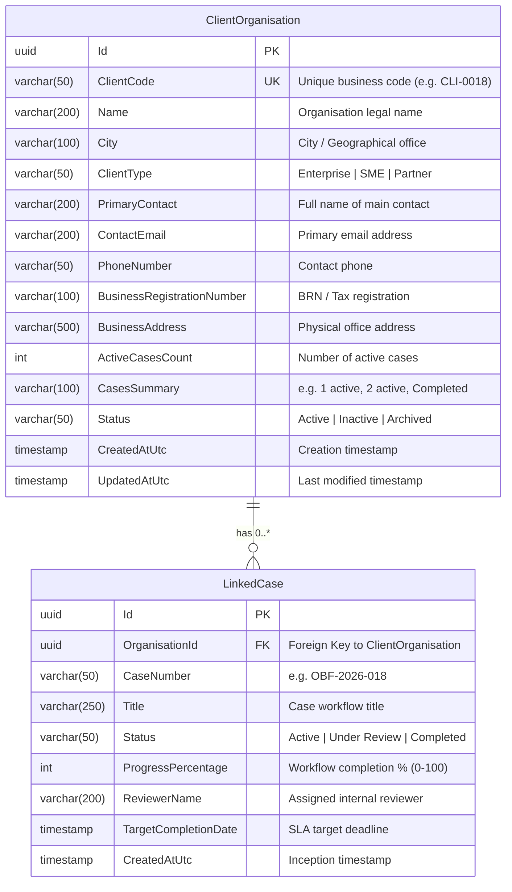

# 🗄️ Database Specification: Client Organisations

This document specifies the Data Persistence Tier design for the **Client Organisations** module, including relational schemas, Entity Framework Core mappings, constraints, indexes, and initial seed datasets.

---

## 1. Entity-Relationship Diagram (ERD)



---

## 2. Table Specifications

### 2.1 Table: `Organisations`

Mapped to entity `ClientOrganisation` in namespace `OnboardFlow.Api.Models`.

| Column | Data Type | Nullable | Constraints / Defaults | Description |
| :--- | :--- | :--- | :--- | :--- |
| `Id` | `uuid` | No | Primary Key, `gen_random_uuid()` | Unique internal GUID |
| `ClientCode` | `varchar(50)` | No | `UNIQUE`, Indexed | External business identifier (e.g. `CLI-0018`) |
| `Name` | `varchar(200)` | No | `NOT NULL` | Registered legal business name |
| `City` | `varchar(100)` | Yes | Default: `''` | City or operating jurisdiction |
| `ClientType` | `varchar(50)` | No | Default: `'Enterprise'` | Client tier (`Enterprise`, `SME`, `Partner`) |
| `PrimaryContact` | `varchar(200)` | No | `NOT NULL` | Designated primary contact person |
| `ContactEmail` | `varchar(200)` | No | `NOT NULL` | Official onboarding contact email |
| `PhoneNumber` | `varchar(50)` | Yes | Default: `''` | Direct line or mobile number |
| `BusinessRegistrationNumber` | `varchar(100)` | Yes | Default: `''` | Statutory registration / PV code |
| `BusinessAddress` | `varchar(500)` | Yes | Default: `''` | Street and corporate address |
| `ActiveCasesCount` | `integer` | No | Default: `0` | Calculated active case count |
| `CasesSummary` | `varchar(100)` | Yes | Default: `'1 active'` | Summary text displayed on Screen 10 |
| `Status` | `varchar(50)` | No | Default: `'Active'` | Operational status (`Active`, `Inactive`) |
| `CreatedAtUtc` | `timestamp with time zone` | No | `CURRENT_TIMESTAMP` | Record creation timestamp |
| `UpdatedAtUtc` | `timestamp with time zone` | Yes | `NULL` | Record last update timestamp |

### 2.2 Table: `LinkedCases`

Mapped to entity `LinkedCase` in namespace `OnboardFlow.Api.Models`.

| Column | Data Type | Nullable | Constraints / Defaults | Description |
| :--- | :--- | :--- | :--- | :--- |
| `Id` | `uuid` | No | Primary Key, `gen_random_uuid()` | Unique internal GUID |
| `OrganisationId` | `uuid` | No | Foreign Key (`Organisations.Id`) | References parent organisation (`ON DELETE CASCADE`) |
| `CaseNumber` | `varchar(50)` | No | `NOT NULL` | Unique case code (e.g. `OBF-2026-018`) |
| `Title` | `varchar(250)` | No | `NOT NULL` | Case workflow description / scope |
| `Status` | `varchar(50)` | No | Default: `'Active'` | Case status (`Active`, `Under Review`, `Completed`) |
| `ProgressPercentage` | `integer` | No | Default: `0` (Range: 0-100) | Overall progress through checklist |
| `ReviewerName` | `varchar(200)` | Yes | Default: `''` | Reviewer assigned to this case |
| `TargetCompletionDate` | `timestamp with time zone` | Yes | `NULL` | SLA deadline |
| `CreatedAtUtc` | `timestamp with time zone` | No | `CURRENT_TIMESTAMP` | Case creation timestamp |

---

## 3. Entity Framework Core Configuration

Configured in `AppDbContext.cs`:

```csharp
modelBuilder.Entity<ClientOrganisation>(entity =>
{
    entity.HasKey(e => e.Id);
    entity.HasIndex(e => e.ClientCode).IsUnique();
    entity.Property(e => e.ClientCode).IsRequired().HasMaxLength(50);
    entity.Property(e => e.Name).IsRequired().HasMaxLength(200);
    entity.Property(e => e.City).HasMaxLength(100);
    entity.Property(e => e.ClientType).IsRequired().HasMaxLength(50);
    entity.Property(e => e.PrimaryContact).IsRequired().HasMaxLength(200);
    entity.Property(e => e.ContactEmail).IsRequired().HasMaxLength(200);
    entity.Property(e => e.PhoneNumber).HasMaxLength(50);
    entity.Property(e => e.BusinessRegistrationNumber).HasMaxLength(100);
    entity.Property(e => e.BusinessAddress).HasMaxLength(500);
    entity.Property(e => e.CasesSummary).HasMaxLength(100);
    entity.Property(e => e.Status).IsRequired().HasMaxLength(50);

    entity.HasMany(e => e.LinkedCases)
          .WithOne()
          .HasForeignKey(c => c.OrganisationId)
          .OnDelete(DeleteBehavior.Cascade);
});

modelBuilder.Entity<LinkedCase>(entity =>
{
    entity.HasKey(e => e.Id);
    entity.Property(e => e.CaseNumber).IsRequired().HasMaxLength(50);
    entity.Property(e => e.Title).IsRequired().HasMaxLength(250);
    entity.Property(e => e.Status).IsRequired().HasMaxLength(50);
    entity.Property(e => e.ReviewerName).HasMaxLength(200);
});
```

---

## 4. Initial Seed Dataset

The database seeder in `Program.cs` automatically populates the four standard organizations from the project UI wireframe:

| Client Code | Organisation Name | City | Type | Primary Contact | Email | Phone | Cases Summary |
| :--- | :--- | :--- | :--- | :--- | :--- | :--- | :--- |
| **`CLI-0018`** | Ceylon Exports (Pvt) Ltd | Colombo | Enterprise | Nimali Perera | `nimali@example.com` | `+94 11 234 5678` | 1 active |
| **`CLI-0017`** | Lanka Foods | Kandy | SME | Dilan Fernando | `dilan@lankafoods.lk` | `+94 81 223 4567` | 2 active |
| **`CLI-0016`** | Oceanic Partners | Galle | Partner | Shanika de Silva | `shanika@oceanicpartners.lk` | `+94 91 334 5678` | 1 active |
| **`CLI-0015`** | Lotus Digital | Colombo | SME | Ruwan Jayasuriya | `ruwan@lotusdigital.lk` | `+94 11 889 0123` | Completed |

---

## 5. Raw SQL DDL (For Direct PostgreSQL Execution)

If running directly in a PostgreSQL environment without EF Core auto-migrations:

```sql
-- Create Organisations Table
CREATE TABLE IF NOT EXISTS "Organisations" (
    "Id" uuid NOT NULL PRIMARY KEY,
    "ClientCode" character varying(50) NOT NULL,
    "Name" character varying(200) NOT NULL,
    "City" character varying(100) DEFAULT '',
    "ClientType" character varying(50) NOT NULL DEFAULT 'Enterprise',
    "PrimaryContact" character varying(200) NOT NULL,
    "ContactEmail" character varying(200) NOT NULL,
    "PhoneNumber" character varying(50) DEFAULT '',
    "BusinessRegistrationNumber" character varying(100) DEFAULT '',
    "BusinessAddress" character varying(500) DEFAULT '',
    "ActiveCasesCount" integer NOT NULL DEFAULT 0,
    "CasesSummary" character varying(100) DEFAULT '1 active',
    "Status" character varying(50) NOT NULL DEFAULT 'Active',
    "CreatedAtUtc" timestamp with time zone NOT NULL DEFAULT CURRENT_TIMESTAMP,
    "UpdatedAtUtc" timestamp with time zone
);

CREATE UNIQUE INDEX IF NOT EXISTS "IX_Organisations_ClientCode" ON "Organisations" ("ClientCode");

-- Create LinkedCases Table
CREATE TABLE IF NOT EXISTS "LinkedCases" (
    "Id" uuid NOT NULL PRIMARY KEY,
    "OrganisationId" uuid NOT NULL REFERENCES "Organisations" ("Id") ON DELETE CASCADE,
    "CaseNumber" character varying(50) NOT NULL,
    "Title" character varying(250) NOT NULL,
    "Status" character varying(50) NOT NULL DEFAULT 'Active',
    "ProgressPercentage" integer NOT NULL DEFAULT 0,
    "ReviewerName" character varying(200) DEFAULT '',
    "TargetCompletionDate" timestamp with time zone,
    "CreatedAtUtc" timestamp with time zone NOT NULL DEFAULT CURRENT_TIMESTAMP
);

CREATE INDEX IF NOT EXISTS "IX_LinkedCases_OrganisationId" ON "LinkedCases" ("OrganisationId");
```
