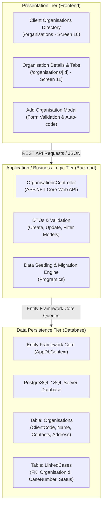

# 🏢 Client Organisations Feature Documentation

Welcome to the official feature documentation for the **Client Organisations** module in **onboardFlow**. This feature provides comprehensive management for client records, onboarding contacts, organizational metadata, linked cases, and portal user access.

---

## 📌 Feature Overview

The **Client Organisations** feature corresponds to **Screen 10 (Client organisations)** and **Screen 11 (Organisation details)** of the system UI wireframes:

- **Screen 10 (`/organisations`)**:
  - Centralized directory of client companies (*Ceylon Exports (Pvt) Ltd*, *Lanka Foods*, *Oceanic Partners*, *Lotus Digital*).
  - Categorization by client tier (*Enterprise*, *SME*, *Partner*).
  - Primary contact person tracking (*Nimali Perera*, *Dilan Fernando*, *Shanika de Silva*, *Ruwan Jayasuriya*).
  - Active and historical onboarding case summary indicators.
  - Multi-criteria search and filter toolbar (search text, client tier filter, status filter).
  - Quick action to add a new client organisation with auto-generated client code (e.g., `CLI-0019`).

- **Screen 11 (`/organisations/[id]`)**:
  - Detailed profile view and editing interface for selected client organisations.
  - Organization metadata: Legal Name, Client Code, Tier, City, Primary Contact, Email, Phone, Business Registration Number, and Business Address.
  - Multi-tab architecture:
    1. **Organisation details**: Editable core company and contact details with real-time validation and persistence.
    2. **Linked cases**: Onboarding workflows, completion progress bars, assigned reviewers, and target completion dates.
    3. **Client access**: Authorized portal user logins, access roles (*Primary Client Admin*, *Document Submitter*), and credentials management.

---

## 🏛️ 3-Tier Architecture Summary

---

## 📁 Included Documents

The documentation in this folder is partitioned into modular, in-depth technical documents:

| Document | Description |
| :--- | :--- |
| **[ARCHITECTURE.md](./ARCHITECTURE.md)** | Full architectural breakdown across Presentation, Application Logic, and Data Persistence tiers, including sequence diagrams and security. |
| **[DATABASE_SPECIFICATION.md](./DATABASE_SPECIFICATION.md)** | Entity data models, table schemas, columns, constraints, indexing, EF Core configurations, and pre-seeded records. |
| **[API_SPECIFICATION.md](./API_SPECIFICATION.md)** | Complete RESTful API documentation, endpoints, HTTP methods, request/response contracts, and error structures. |
| **[FRONTEND_SPECIFICATION.md](./FRONTEND_SPECIFICATION.md)** | UI/UX specifications, wireframe matching for Screen 10 & 11, component architecture, styling guidelines, and state handling. |
| **[TESTING_AND_VERIFICATION_GUIDE.md](./TESTING_AND_VERIFICATION_GUIDE.md)** | Step-by-step instructions for testing across all three tiers using curl, browser UI, and integration assertions. |

---

## 🚀 Quick Navigation Links

- **Frontend Pages**:
  - List View: [`frontend/app/organisations/page.tsx`](file:///e:/4th%20sem/Software%20project/Implimentation/onboardFlow/frontend/app/organisations/page.tsx)
  - Detail View: [`frontend/app/organisations/[id]/page.tsx`](file:///e:/4th%20sem/Software%20project/Implimentation/onboardFlow/frontend/app/organisations/[id]/page.tsx)
- **Backend Components**:
  - Controller: [`backend/src/OnboardFlow.Api/Controllers/OrganisationsController.cs`](file:///e:/4th%20sem/Software%20project/Implimentation/onboardFlow/backend/src/OnboardFlow.Api/Controllers/OrganisationsController.cs)
  - Entity Model & DTOs: [`backend/src/OnboardFlow.Api/Models/ClientOrganisation.cs`](file:///e:/4th%20sem/Software%20project/Implimentation/onboardFlow/backend/src/OnboardFlow.Api/Models/ClientOrganisation.cs)
  - Database Context: [`backend/src/OnboardFlow.Api/Data/AppDbContext.cs`](file:///e:/4th%20sem/Software%20project/Implimentation/onboardFlow/backend/src/OnboardFlow.Api/Data/AppDbContext.cs)
  - Migration & Seeding: [`backend/src/OnboardFlow.Api/Program.cs`](file:///e:/4th%20sem/Software%20project/Implimentation/onboardFlow/backend/src/OnboardFlow.Api/Program.cs)
